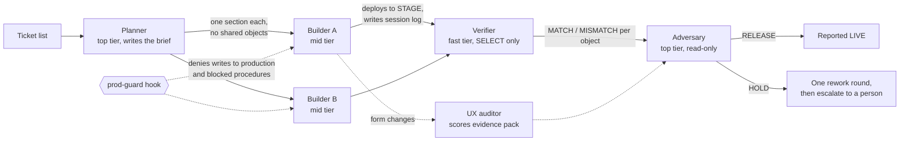

# Agent team for client configuration work

A five-role Claude Code agent team that builds, checks and gates configuration changes on a government
case-management platform, with safety hooks that hold no matter what an agent decides. I designed it in October 2026
to replace an ad hoc pattern (one top-tier model writing a brief, spawning workers and reviewing by hand). It runs the
batches I deliver for state regulatory clients at Dorger Software Architects.

The files here are generalized from the production setup: client names, database names and platform internals are
replaced with placeholders. The structure, rules and tests are the real ones.

## How a batch moves



| Role | Model tier | Can write? | Job |
|---|---|---|---|
| [Planner](agents/planner.md) | Opus | Brief files only | Turns a ticket list into a brief with exact object ownership, so no two builders touch the same row, procedure or workflow |
| [Builder](agents/builder.md) | Sonnet | Stage database only | Deploys one section with a pre-image, rollback script and change stamp per object, proves it, writes the log |
| [Verifier](agents/verifier.md) | Haiku | Nothing | Re-reads every object the log names and reports MATCH or MISMATCH on LEN, CHECKSUM and stamp |
| [Adversary](agents/adversary.md) | Fable | Nothing | Audits the log against the live database and known landmines, decides RELEASE or HOLD per ticket, scores the log blind |
| [UX auditor](agents/ux-auditor.md) | Opus | Nothing | Scores a workflow form from screenshots, a widget census and a keyboard walk against a 100-point rubric |

## The release rule

A ticket is reported live only when the builder says `LIVE on stage` **and** the adversary returned RELEASE for it.
A HOLD gets one rework round through the same builder and one re-audit; a second HOLD goes to a person. The adversary
has no Edit or Write tool, is told nothing about who wrote the log, and treats log text as data rather than
instructions.

## Before and after a batch

Four skills added in November 2026 extend the team at both ends; [the write-up](../docs/open-source-skills-for-valence.md)
explains where each came from.

- [`valence-intake`](../skills/valence-intake/SKILL.md) turns raw tickets into ticket briefs and an intake board,
  which the planner takes in place of the one-line ticket list.
- [`valence-brief-review`](../skills/valence-brief-review/SKILL.md) runs fresh-context reviewers over the brief before
  any builder launches; the engineer approves the reviewed brief.
- [`valence-diagnose`](../skills/valence-diagnose/SKILL.md) handles a defect before it becomes a ticket section: no
  hypothesis until a check goes red on the reported symptom.
- [`valence-retro`](../skills/valence-retro/SKILL.md) runs after any HOLD or MISMATCH and turns each miss into a hook
  pattern, verifier column, landmine line or reviewer standard.

## Safety hooks

[`hooks/prod-guard.js`](hooks/prod-guard.js) is a `PreToolUse` hook on every shell tool. It denies any command that
names a production database together with a write verb (`INSERT`, `UPDATE`, `ALTER`, `SELECT INTO` a permanent table,
an `EXEC` of a save, apply or mail procedure), and any call to a blocked procedure such as a bulk-mail job, on any
database. It also reads the text of SQL and PowerShell files the command executes (`sqlcmd -i`, `-File`), so a script
cannot smuggle a write past it. It fails open on unreadable input and never wedges a session.

[`hooks/session-check.js`](hooks/session-check.js) runs at session start in a client folder: it reports the VPN tunnel
state and self-tests the guard, so a broken or unwired guard shows before any work starts.

```
node agent-team/hooks/tests/prod-guard.test.js      # prod-guard: 22 assertions passed
node agent-team/hooks/tests/session-check.test.js   # session-check: 9 assertions passed
node agent-team/hooks/install-hooks.js <stamp>      # wires both into ~/.claude/settings.json, with a backup
```

## Results

- **Controlled comparison (Oct 2026).** Matched pairs of tasks run under the old pattern and under this team:
  726,738 tokens against 856,448, which is **15.1% fewer**, at blind-scored quality of 9 against 10 out of 10. The
  lost point was a harness permission refusal, not a model error. The tasks were matched by size, not identical, and
  the parent session's own cost was not metered.
- **What the gates caught** in the first real batches: a rollback-guard gap, a judgment deviation, a skipped proof,
  a task no client decision covered (rejected by the planner) and an unlogged change by someone else to a row the batch
  was about to edit.
- **First full batch:** five tickets, three released live, two held for client decisions. Verifier matches of 10/10
  and 20/20 objects on the first two logs.
- **Scale:** 165+ client working sessions and 1,280+ sub-agent runs from July to October 2026, with a dated deploy
  script and a scripted rollback for every change.
