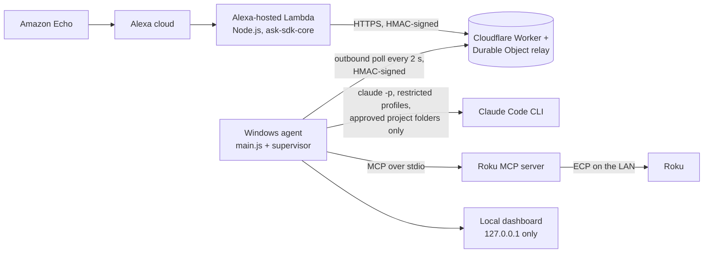

# JARVIS for Alexa: voice control for Claude Code and the TV

*"Alexa, ask Dorgersoft Helper to fix the login page."* JARVIS lets me start and follow Claude Code tasks on my
Windows PC, ask Claude questions, and control the TV by talking to an Amazon Echo. It reuses the Claude Code CLI
(no separate API key) and the same [Roku MCP server](../mcp-servers/roku-mcp/) Claude Code already uses. Built
November 2026 in TypeScript.

## Architecture

The PC accepts no inbound connections. The relay queues commands (they expire after 45 to 120 seconds), stores
results and rate-limits callers; the agent polls it over HTTPS. Long coding tasks answer at once ("Started task 4")
and keep running; "what is Claude working on" and "whether Claude finished" read the relay's snapshot later.

## Voice surface

| Ask | What happens |
|---|---|
| "start a coding session", "work on my CRM project" | Opens or switches the active project (fuzzy name match) |
| "fix the login page" (and 15 other verbs) | Starts a background Claude Code task with the edit profile |
| "what Claude is working on", "whether Claude finished" | Reads the running task's latest activity or its result |
| "stop the current coding task" | Kills Claude and every process it started |
| "ask Claude a question", "explain recursion" | Answers inside the same Alexa turn, or acknowledges and reads the answer later |
| "for my project summary" | Starts a read-only summary task |
| "open YouTube", "pause the TV", "turn the volume up" | One of 16 allow-listed Roku actions |
| "play lofi" | A named shortcut: a Spotify playlist deep link, one command at a time |

## Security

- **Signed requests on every hop.** HMAC signatures with separate Lambda and agent keys, a 120-second clock window
  and single-use nonces; forged, unsigned and replayed requests are refused (tested end to end).
- **Least privilege for Claude.** Three CLI profiles: *ask* (safe mode, no tools, small model), *readonly* summary,
  and *edit* (restricted, accept-edits, strict MCP config). Coding runs only inside configured project roots, checked
  by real path so `..` and junction escapes are rejected, including a folder that later reappears as a junction.
- **Clean environment.** Every `CLAUDE*` and `ANTHROPIC_*` variable is stripped before the CLI is spawned, and the
  prompt goes in on stdin, never through a shell.
- **Roku allow-list.** Only 16 named actions reach the MCP server.

## An engineering constraint worth noting

Cloudflare's free plan caps SQLite-backed Durable Objects at 100,000 rows written per day, after which writes fail
until midnight UTC. Polling every 2 seconds with a nonce, rate and presence write per request would have hit that
around 6 PM every day. The relay keeps nonces, rates and last-seen times in Durable Object memory instead, with a
boot-time replay rule (nothing signed before the object started is accepted) and throttled snapshot writes.

## Tests

| Suite | Result |
|---|---|
| Shared (auth, validation) | 75 pass |
| Relay, including the bundled Worker in local workerd (Miniflare) | 180 pass |
| Agent (Claude runner, tasks, config, Roku, shortcuts, supervisor) | 242 pass, 1 opt-in live test skipped |
| End to end: the real Lambda handler, the real relay and the real agent process together | 52 pass, 3 opt-in live tests skipped |
| Alexa skill (handlers and interaction-model lint) | 103 pass |

**656 tests, 652 passing, 0 failing; the 4 skipped are opt-in live tests.** Live checks passed against the real
Claude CLI (readiness probe, 2.6 s, $0.0005) and the real Roku (status and now-playing through the agent). Three review
rounds fixed the findings they raised before release. Cloud deployment and on-device Echo tests are the remaining
steps.

## Before this: JARVIS desktop (July 2026)

A Python hotkey assistant: local faster-whisper speech-to-text, neural text-to-speech, a persistent headless
`claude -p` session, "spawn an agent to ..." for independent background Claude sessions, and a mission-control
dashboard with per-agent cards and stop buttons. Its recorded lessons (Whisper before COM initialization, never leave
a stderr pipe unread, MCP start-up cost per headless agent) shaped the Alexa build.
