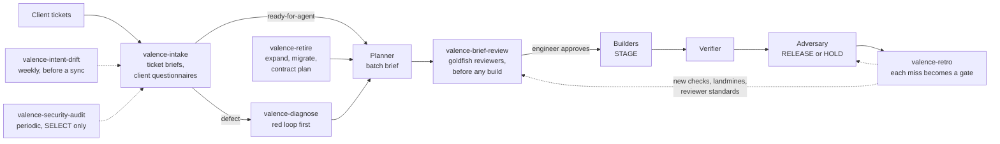

# Open-source skill libraries, adapted for Valence work

In November 2026 a [post on X](https://x.com/danikkk_wqs/status/2119535297541070962) listed five public libraries of
AI-agent skills. I had Claude Code clone all five, read about 80 skills against the Valence configuration work my
[agent team](../agent-team/README.md) does, and adapt the methods that fill real gaps in it. The result is seven new
skills under [`skills/`](../skills/). This page records what was taken from where, what was left out and why, and what
still has to be checked before the skills run on a client system.

The skills are generalized: no client, database or host names, and platform tables are left for the atlas to
supply. They have not yet been run against a client system.

## Where the new skills sit

| Skill | Gap it fills | Adapted from |
|---|---|---|
| [`valence-intake`](../skills/valence-intake/SKILL.md) | The planner's input was one line per ticket; gaps surfaced later as HOLDs | mattpocock/skills (triage, grilling, to-questionnaire); addyosmani/agent-skills (interview-me) |
| [`valence-brief-review`](../skills/valence-brief-review/SKILL.md) | The team reviewed only after the build; nothing checked the brief before it | google/elephant-goldfish-model (review loop, resolve, reviewers); addyosmani/agent-skills (doubt-driven development) |
| [`valence-diagnose`](../skills/valence-diagnose/SKILL.md) | Silent failures were debugged by guessing and redeploying | mattpocock/skills (diagnosing-bugs); addyosmani/agent-skills (debugging-and-error-recovery) |
| [`valence-retire`](../skills/valence-retire/SKILL.md) | Shared procedures, lookups, workflows and templates were changed in place | addyosmani/agent-skills (deprecation-and-migration, Hyrum's Law) |
| [`valence-retro`](../skills/valence-retro/SKILL.md) | A HOLD was fixed once and could recur under another builder | mattpocock/skills (retro); addyosmani/agent-skills (constraint-driven floor guard) |
| [`valence-intent-drift`](../skills/valence-intent-drift/SKILL.md) | The atlas compares config with config; nothing compared the client's decisions with live config | google/elephant-goldfish-model (drift report); mattpocock/skills (dated-claims rule) |
| [`valence-security-audit`](../skills/valence-security-audit/SKILL.md) | No structured security pass over a client's portal, roles, dynamic SQL, workflows, templates and mail | cloudflare/security-audit-skill |

## What came from each library

### google/elephant-goldfish-model

The elephant holds the context and drafts; goldfish are fresh subagents that review the draft without the
conversation that produced it. Two pieces carried over:

- **The review loop** became `valence-brief-review`. The design document becomes the planner's batch brief (or a
  per-ticket configuration design for a risky ticket). The upstream reviewer roster was rebuilt for configuration:
  scope and recorded decisions, simplest configuration, a cold builder on the builder's own model tier,
  zero-decision build steps and proofs, live STAGE grounding (SELECT only), a landmine critic on Fable, and client
  wording. The resolve categories (contest with checkable evidence, escalate, fix, decline) and the rules around them
  were kept. The loop now converges on one clean round instead of two and caps at three rounds instead of five, to
  fit fixed-price budgets and the team's existing one-rework-then-a-person rule.
- **The drift report** became `valence-intent-drift`, comparing Why-This-Config, Do-Not-Configure, scope and answered
  Open-Questions notes with live configuration. Upstream's four categories gained five Valence ones: forbidden,
  unlogged change, environment split, embedded drift and undocumented.

Left out: the bootstrap skill (the atlas does that job), the per-host adapters and packaging, the TRIZ catalogue, the
structural Markdown reviewer, and code search.

### cloudflare/security-audit-skill

The method carried over almost whole into `valence-security-audit`: reconnaissance, a coverage ledger of units
(surface, boundary, attack class), isolated hunters assigned from it, coverage critics, a fresh verifier per candidate
that tries to disprove it, three strict verdicts (`confirmed`, `needs_validation`, `rejected`), independent record
verification, and additive runs. The attack classes were rewritten for Valence: portal exposure, applicant isolation,
roles and permissions, dynamic SQL, workflow integrity, templates and exports, outbound mail, derived copies, portal
identity linking, change trail, secrets, and environment drift.

Left out: the sandbox and artifact-promotion machinery, which exists to run untrusted code and has no place in a
SELECT-only audit, and the code, binary, browser and protocol attack classes, which the platform owns. The upstream
validators were not reused. They open files with flags Node does not offer on Windows, where this work runs, and their
schema is shaped for source files and line numbers. The skill ships its own smaller validators with tests.

### mattpocock/skills

- **diagnosing-bugs** gave `valence-diagnose` its central rule: no hypothesis until a feedback loop exists that goes
  red on the reported symptom. The loop menu was rebuilt from Valence parts: the widget's procedure with its exact
  parameters, a save check, a payload replay, STAGE against PROD, an embedded copy against its standalone row, and
  `Modified` stamps in place of git bisect.
- **triage, grilling and to-questionnaire** became `valence-intake`: duplicate and prior-rejection checks by
  concept, verifying the claim before asking anyone anything, a decision frontier with a recommended answer per
  question, and a client questionnaire that never invites new scope.
- **retro** gave `valence-retro` its rule that a mechanical miss gets a deterministic check, not a written rule.
- **chief-of-staff** contributed one rule to `valence-intent-drift`: every "currently" claim in a note carries a date.

Left out: TDD, module design, git and PR workflows, prototyping and the writing skills, none of which maps onto
configuration rows.

### addyosmani/agent-skills

- **doubt-driven-development** gave `valence-brief-review` the rule that reviewers get the artifact and the contract
  but never the author's claim that it is right, and the "doubt theater" red flag.
- **debugging-and-error-recovery** gave `valence-diagnose` its stop-the-line start and the layer tree, rebuilt as
  nine Valence layers from page and widget down to the outbound-mail gate.
- **deprecation-and-migration** and Hyrum's Law gave `valence-retire` expand, migrate and contract as separate
  stamped phases, and the list of observable surfaces consumers depend on.
- **constraint-driven-development** gave `valence-retro` its floor guard ("tightening the bar should be silent;
  loosening it should be loud") and ratchets on atlas metrics.
- **interview-me** gave `valence-intake` the explicit-yes rule: "sounds good" is not a decision.

Left out: the React, web-performance, DevTools, CI and OWASP web-app material.

### kepano/obsidian-skills

Not adapted. These skills teach an agent Obsidian's file formats (wikilinks, callouts, Bases views, JSON Canvas), and
the fit depends on whether the client knowledge bases are opened as Obsidian vaults, which nothing here establishes.
KB writes also go through an ingestion service, not straight into a vault. One idea is worth keeping either way: if the
atlas assembler wrote typed frontmatter on each note (object type, roles, portal exposure, dynamic SQL, `ModifiedBy`,
CHECKSUM), any reader, Obsidian Bases included, could filter the atlas as a table.

## Smaller borrows not yet applied

These are single rules from the libraries that would improve existing agents or notes, but were not worth a skill of
their own:

- A "noticed but not touching" block in the builder log, so scope-change candidates are recorded instead of fixed
  (agent-skills, incremental-implementation).
- In adversary findings, label defects that predate the batch separately from regressions, since under fixed price a
  pre-existing defect is a scope question (agent-skills, code-review-and-quality).
- "Do not infer approval from a previous conversation unless a durable artifact records it" (agent-skills,
  context-engineering).
- Alternatives and superseded-by lines on Why-This-Config notes, borrowed from the ADR format (agent-skills,
  documentation-and-adrs).
- A one-way or two-way door line in each builder log; touching the outbound-mail gate is a one-way door
  (mattpocock/skills, pr).
- A description-collision check across all skills, so two skills do not trigger on the same request (agent-skills
  evals).

## Assumptions to confirm before first use

The writers had to assume some platform facts that the public material here does not settle. Each skill flags the ones it depends on.
The ones that matter most:

1. The same object can have different ids on STAGE and PROD, so objects are matched by name or stable key.
2. A parent workflow runs its embedded copy at runtime, not the standalone row.
3. Workflow catalog rows carry `Modified` but no `ModifiedBy`.
4. The outbound-mail gate is a per-environment setting whose state can be read, and STAGE normally holds mail.
5. Whether the environment sync carries procedures as well as settings, lookup and workflow rows.
6. SELECT reads of PROD are permitted for diagnosis, drift and dependency searches; the security audit reads PROD only
   if the client allows it.
7. The client's known-landmines list is a file the adversary reads, so retro and brief review can add to it.
8. The planner prompt still takes "numbers and titles, one line each"; it now also accepts the intake board.

## Licenses

The four adapted libraries are MIT (mattpocock/skills, addyosmani/agent-skills, cloudflare/security-audit-skill) and
Apache-2.0 (google/elephant-goldfish-model). Each skill ends with a Credits section, and
[`THIRD_PARTY_NOTICES.md`](../THIRD_PARTY_NOTICES.md) maps each skill to the upstream commit read and carries the
license texts. No upstream code is included.
