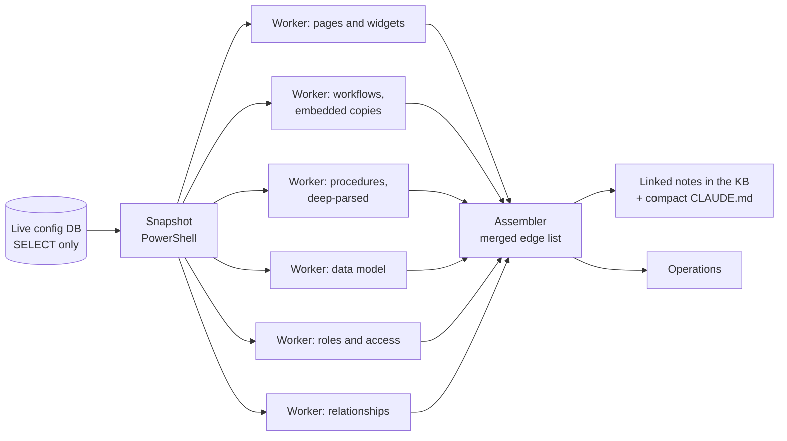

# System atlas: mapping a live platform into a knowledge graph

`valence-atlas` is a Claude Code skill plus 22 scripts (about 5,800 lines of Node.js, Python and PowerShell) that
reads a live configuration-driven case-management system with SELECT-only queries and writes a cross-linked
knowledge-base "atlas": every tab, dashboard, widget, workflow, table, lookup, role and user, and how they relate.
The skill source stays private because its references name client systems; this page describes how it works.

## Pipeline

Operations built on the same graph: change impact, drift watch between snapshots, configuration lint, UAT test-script
skeletons, link checking, environment-sync planning, embedded-workflow drift, log triage, a value finder, a record
tracer, and (November 2026) form readiness.

## Results

- One agency, refreshed by six parallel agents and an assembler in about 2.5 hours: 277 pages, 2,103 widgets,
  225 workflows (60 embedded copies, 10 found drifted from their standalone row), 595 procedures inside 713 modules,
  1,286 tables, 112 roles, 248 users and **10,650 traced dependencies**. Broken links went from 179 to 0.
- The drift tool attributed 6,159 changes over 22 days to logged sessions and surfaced one session nobody had logged.
  The refresh overturned several assumptions the team had been working from.
- November 2026: one agent per system ran it across **all nine reachable client systems** and graded readiness for
  **1,339 forms** (blocked, not ready, unproven, DSA-owned, client-owned).
- Versions 1.0 to 1.3 with a changelog of lessons learned on each run.

## Related skills (private)

`valence-form-readiness` (inventory every form and grade it), `crm-ux-auditor` (the 100-point form rubric behind the
[UX auditor role](../agent-team/agents/ux-auditor.md)), `workflow-diagram` (turns a 30 to 200 activity workflow file
into an 8 to 15 step client diagram, every step traceable to the source JSON).
