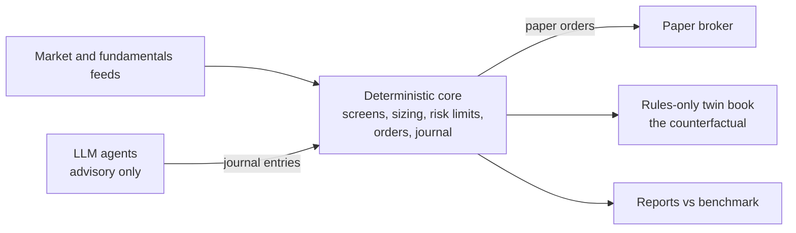

# Trading systems and financial models (paper trading and research)

Personal projects, separate from my client work. All of them trade on paper. Ground rules in every repo: the agents
build research and tooling; they never place real trades, move funds or handle keys. Results are reported with their
sample size, including the null results, and no performance figures are claimed here.

## The design pattern they share

Code owns every order and every limit. Language models may advise, score or veto inside a fenced interface, and a
rules-only twin measures whether they add anything.

## FOMO: real-time crypto research lab (Sep to Oct 2026)

- Scanner for new Solana tokens, a safety filter, a transaction-cost model and a paper-trading lab with a random
  control and a pre-registration ledger of experiments (1,300+ lines).
- Python, SQLite in WAL mode, websocket account subscriptions for real-time pool prices with failover to a keyed
  provider and a credit-budget meter, a scikit-learn classifier, and a Starlette data API with bearer tokens and SSE
  streaming. Runs 24/7 in Docker on DigitalOcean; an Electron desktop client reaches it through an SSH tunnel.
- **43,600 lines of source Python, 1,080 tests.** An autonomous research agent on the server deploys only through
  whitelisted commands after sealed test runs. An independent review logged 36 findings, all addressed.
- Outcome: the studies found no cost-adjusted edge, and the lab reported exactly that.

## GrokStocks: AI-advised equities portfolio manager (Oct 2026)

- Core sleeve (quality and growth holdings built in tranches), a swing sleeve and a T-bill reserve, benchmarked to the
  S&P 500 total return.
- Five xAI Grok agents (Analyst, PM, Scout, Judge, Reviewer) can read and write a journal line and nothing else. A
  rules-only twin book is the counterfactual.
- Alpaca paper API (the code refuses any non-paper host), SEC EDGAR XBRL point-in-time fundamentals, Finnhub earnings
  dates, z-score quality and growth screens, a risk committee with caps, vetoes and drawdown states, fill
  reconciliation, a dividend ledger, a New York market clock with early-close rules, and a kill file.
- Built from a 15-task plan by implementer and reviewer agents: **216 tests passing with warnings as errors and network
  sockets blocked.**

## ColtFutures: a futures price-action model (Oct 2026)

- A 347-line Pine Script v5 indicator ported to a Python engine, a setup rule with features and outcome labels, a
  logistic walk-forward scorer, and a forward paper grader that runs daily.
- **2,863 backtested trades** on 2019 to 2022 Databento data in an exploration sandbox, with every session from 2023
  onward sealed as a one-read holdout. No fixed rule showed an edge in the sandbox, so the holdout stays sealed.

## Earlier platforms (Jun to Jul 2026)

- **Trading Intelligence Platform:** prediction-market wallet consensus turned into risk-checked signals that need
  manual approval in Discord. FastAPI, PostgreSQL 16 with Alembic, a Redis event bus, five specialized agents, an LLM
  with heuristic fallbacks, confidence-scaled stops, a daily-loss circuit breaker and nightly backups; 10,600 lines.
- **futurestrader:** a multi-agent intraday design where a deterministic risk layer can veto an LLM GO/NO-GO gate,
  with post-trade analysis feeding a rolling memory, and a read-only .NET 8 WPF dashboard. A 105-agent literature
  review I ran concluded that published "LLM agents beat the market" claims do not survive scrutiny, which is why the
  later projects fence the models in.

## Quant methods used

Walk-forward logistic models, factor z-score screens, transaction-cost models, bootstrap confidence intervals,
pre-registered hypotheses with success bars written before data is read, one-read holdouts, random-control baselines,
benchmark reconciliation against total return.
