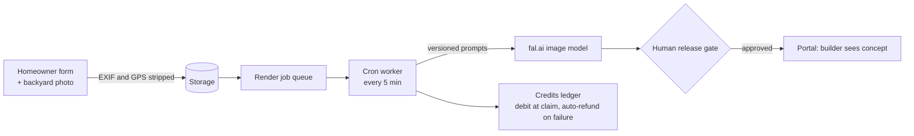

# Vantage Render Co.

**Live at [vantagerender.com](https://www.vantagerender.com)** (marketing site) and
[vantagerender.dev](https://vantagerender.dev) (lead-capture demo).

My own company: a studio that turns a homeowner's backyard photo into an AI-generated pool concept, so pool builders
walk into the sales call with a picture of the customer's own yard. I built and run all three properties (172 commits,
about 49,000 lines of TypeScript and 12,000 lines of SQL across three repos). Source stays private; this page covers
the engineering.

## Three properties, one database

| Property | Stack | Job |
|---|---|---|
| Marketing site | Vite, React, three.js (Gaussian-splat 3D) | Sells the service |
| Client and team portal | Next.js 16, React 19, TypeScript, Tailwind v4, shadcn/ui | Builders see leads, concepts and deliverables; the team runs production |
| Lead-capture demo | Next.js, embeddable widget, white-label branding per builder | Homeowner uploads a photo and gets a concept |

All three share one Supabase project (Postgres, Auth, Storage) and deploy on Vercel.

## Render pipeline

## Security model

- Tenant isolation is enforced in the database, not the app: row-level security is enabled **and forced** on every
  table, clients get SELECT only, and every client write goes through an audited `SECURITY DEFINER` function.
- `npm run test:rls` runs **41 tenant-isolation assertions** over real HTTP sessions; `npm run security:gate` checks
  schema invariants; a migration check compares both repos with the live migration ledger (70 migrations) before any
  deploy.
- Playwright end-to-end tests with an axe accessibility scan and a 390px layout gate in CI.

## Integrations

Resend email outbox with leases and retries, an outbound webhook engine for GoHighLevel CRM, Sentry, and an
**MCP endpoint** with scoped tokens so AI agents can work leads and projects through the same audited functions.

## Business

Pricing tiers, a launch-readiness audit, legal drafts for attorney review, a researched prospect pipeline, and a pilot
with a New Orleans pool builder (a demo, then a four-week free trial with white-label branding).
